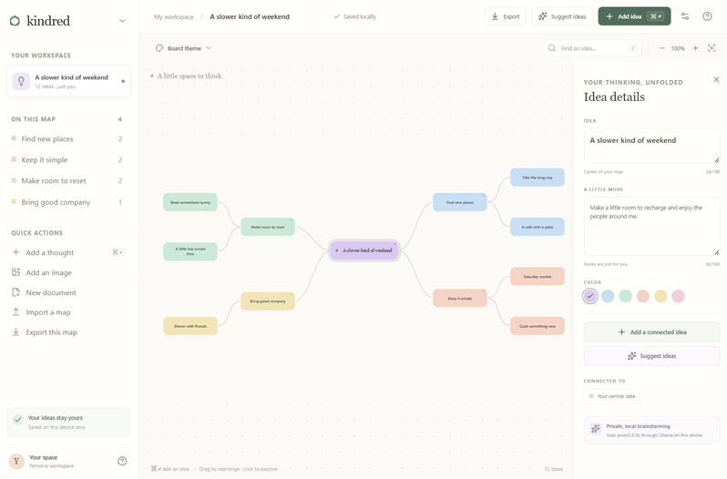

# Kindred

Kindred is a local-first mind-mapping desktop app. The React and TypeScript interface runs inside a Tauri window, and its Rust backend stores the current map in the operating system's application-data directory. In a regular browser, the app uses local storage instead.
 
## Run the desktop app

Install the prerequisites for [Tauri 2](https://v2.tauri.app/start/prerequisites/), then run:

```powershell
npm install
npm run app
```

To create a desktop bundle, run `npm run app:build`. To work on the frontend in a browser, run `npm run dev`.

## Mind maps

Add connected ideas, write notes, change colors, search the map, and adjust the canvas zoom. Drag the board background to pan, or drag individual ideas and images to rearrange them. Images and ideas can be nested under ideas or images, with their connections shown on the board. Choose from five board themes and add images that are resized and stored with the map.

Changes are saved locally as you work. Use Import and Export to move a map as a JSON file. Choose **New document** to replace the current map with a fresh one; the app asks for confirmation first.

Select an idea and choose **Suggest ideas** to get 3–10 concise child-node suggestions from a local model. Suggestions use the selected idea, its parent, and its immediate child ideas as context; nothing is added until you choose a suggestion.

Suggestions run through the local LLM provider interface, currently backed by Ollama. Ollama must be installed and running on this device. Open **AI settings** to check Ollama and model status or configure a model tag. Kindred defaults to `qwen2.5:3b`; if it is missing, choose **Download model** to fetch it through Ollama. Models are downloaded only on request and are never included in the installer. AI features are optional and do not send map content to cloud APIs.
